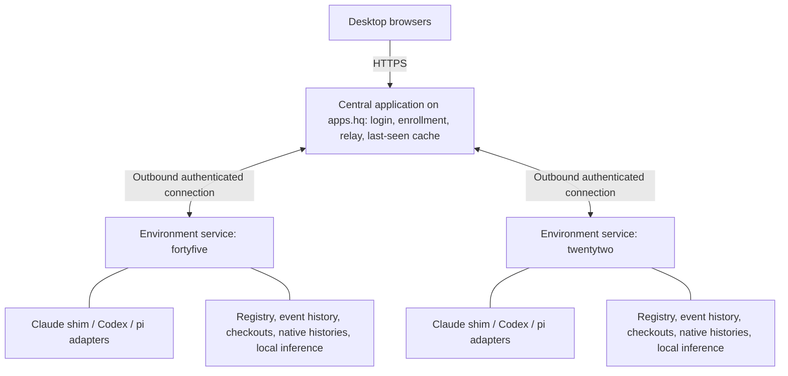

# Roundhouse

Design draft, revised 2026-11-09. A future-state description, not a report of built behavior; what exists is described in `docs/current/roundhouse.md`. Where something is still provisional it says so; everything else is decided. The harness evidence this leans on is in `docs/research/harness-capabilities.md`, and anyone planning against this should check installed versions rather than assume those observations hold forever.

## What it is

Roundhouse is a project-oriented workspace for working directly with a gang of coding agents spread across development environments. One place to converse, see where attention is needed, and return to work without rebuilding a pile of terminal windows. It is not a coordinating agent, not a replacement harness, and not an IDE.

The problem it solves is attention. Michael makes circuits between projects, each with a few collaborators, and the cost is not switching windows... it is recovering what each agent needs, which conversation to enter next, and who is waiting on whom. After a reboot that cost becomes a reconstruction job: finding the native sessions among GUIDs and rebuilding the arrangement. Roundhouse keeps the arrangement separate from the processes doing the work, so a reboot interrupts execution without erasing the project map, and a project can be deliberately put down and picked up later with its conversations and place intact.

Michael speaks to the agents directly. There is no intermediary model deciding what to send or where. Claude Code, Codex, and pi stay native harnesses with their own loops, permissions, and session stores; Roundhouse accommodates what they can do rather than replacing it. Project truth stays in repositories. Roundhouse holds arrangement and reading state, never a competing copy of specs or agent memory.

## The shape

An **environment** is where a project's work physically happens: a place that runs one environment service and holds checkouts, harness installs, native session stores, and harness logins. Today that means the `fortyfive` and `twentytwo` workstations. Later it could mean a container per project on either of them, which is why the identity belongs to the environment and not the machine, and why the service runs inside the environment rather than reaching into it from outside. A workstation hosting five project containers would have five enrolled environments. The one real cost containers carry is that so much of what a harness needs lives outside the checkout (logins, trust state, configuration, the session stores themselves) and would have to be provisioned or mounted. That work is deferred, but the shape leaves room for it.

A **project** is the stable home for work: a display name, an environment, and a checkout. Registering one is small (pick a connected environment, pick an existing checkout, name it). Its conversations stay with it when their processes exit, when the environment goes offline, and when the project is suspended. Removing a project never deletes its checkout or native histories. One registration per checkout per environment is the ordinary case; moving a project between environments is a deliberate operation, not a field edit.

A **conversation** is a durable identity wrapped around a native harness session. The session id, environment, and checkout are plumbing, not its name. A conversation is not a permanent role: one agent might carry a small change end to end, and a bigger effort might start fresh design, planning, and implementation conversations. Roles are optional labels, and projects may gather conversations into an optional named work group (provisional: the grouping interactions are still to be worked out). Grouping never implies a pipeline engine, and Roundhouse never merges model contexts because it groups their conversations.

A **runtime** is the harness process or server thread currently executing. It can stop without the conversation going anywhere, and reopening a conversation need not start a process, let alone a model turn. Each conversation runs in one of two modes. In the long-lived mode, which is the default, the process stays alive between turns, which keeps MCP servers connected and background work flowing, and means the conversation has a managed writer even when idle. In the per-turn mode, opt-in per conversation with a per-harness default and a global switch, the process exits at the end of each turn and the next prompt resumes the exact session. Per-turn makes terminal handoff and suspension nearly free, at the cost of per-turn startup and of anything that keeps state inside the harness process. Mercurius and terminus both do that today (session state in memory, review rounds running inside the MCP server), so conversations that drive them stay long-lived until those brokers are made restartable in their own repos. That is follow-on work the practice can ease into one conversation at a time, not a prerequisite.

## Working in it

The main surface is a stable project and conversation navigator beside one generous selected conversation. Navigation stays put rather than re-sorting collaborators by their latest output, so a project's structure becomes spatially familiar. The selected conversation quietly shows its harness, model and effort where available, runtime mode, and environment and checkout. Launching means choosing a harness and writing the opening prompt; environment and checkout come from the project, and native settings are inherited rather than silently stripped. Desktop first; mobile is a later fallback.

```text
+---------------------------+------------------------------------------+
| Needs you                 | Project / work group / conversation      |
|                           | Harness · model · effort · mode · env    |
| Projects                  +------------------------------------------+
|  archive                  |                                          |
|    Storage durability     | Conversation                             |
|      Planning             |                                          |
|      Implementation       | Messages, tool activity, requests,       |
|  frame                    | and readable native history              |
|  punchbuggy               |                                          |
|                           +------------------------------------------+
| Suspended projects        | Reply                                    |
+---------------------------+------------------------------------------+
```

Attention has two routes: a compact cross-project list, and a keyboard shortcut to the next waiting conversation. Both open the conversation inside its project. Replying does not move focus, because a reply may start a discussion rather than finish a queue item. Opening a conversation acknowledges what was read and nothing more; a pending approval or question stays pending until answered. Unread output and an explicit request are kept visibly distinct.

Three native states carry the first version: running, turn ended with unread output, and request pending (a question, an approval, or a dialog). In this practice almost every turn end means the agent is waiting on Michael, since the planning and implementation roles stop after each finding, so "turn ended, unread" is the ordinary waiting state and needs no inference to be useful. The adapters do some classifying: a Codex agent asking a question in default mode keeps its turn active and sleeps, so an `agentMessage` carrying `questions[]` must read as a request, not as work in progress. Error and unreachable are shown as what they are.

On top of the native facts sits the **re-entry briefing**, a short reading written for Michael arriving back at a project after circuits elsewhere: what was decided recently, what is being asked of him, where each conversation stands and how they relate.

```text
Planning
  Needs your decision on migration compatibility.

Implementation
  Appears to be waiting for the revised work order.
  Planning has since posted a revision.
```

The briefing is generated by local inference in the environment at the end of a turn, from a bounded recent window plus the previous briefing, and cached beside the conversation as derived state. It links to the messages it leans on, keeps its uncertainty in its wording, is labeled stale the moment newer activity arrives, and is labeled unavailable rather than shown old. Native requests and runtime facts always outrank it. It cannot send, approve, resume, or edit anything, and its failure blocks nothing. It is a later stage; the first stage records turn boundaries and event history in the form it will consume. The test of whether it works is whether it saves Michael from rereading several conversations, not whether it produces a formal workflow graph.

## How it is built

Two kinds of service, of which only the second exists in the first build. The **central application** on `apps.hq`, reachable at `roundhouse.hq.quigley.com`, handles browser login, enrolls environments, relays commands and state between browsers and environments, assembles cross-project views such as the attention list, and keeps a last-seen snapshot of each environment. The **environment service** runs in each environment and owns managed execution: launching harnesses, draining their event streams, tracking the current pending-request set, delivering replies, and running each harness's particular shutdown and resume sequences. It keeps going whether or not a browser or the central application is up. It is not a pipeline engine: it does not choose agents, advance stages, or decide that a work order is ready.



**Truth lives in the environment.** The environment service is the single authority for everything about its projects: the registration, the conversation roster with native ids and modes and labels, the event history and pending set, reading position, cached briefings, and whether each project is suspended. The central application owns only the login database, the enrollment records, and the snapshot, and the snapshot is a cache, never an authority. While an environment is connected its state is relayed live; while it is offline the snapshot is shown labeled as last seen. Browsers never write workspace state directly... every change is a command to the owning environment, and the environment's confirmed state is what every browser renders, which is also how two browsers stay consistent. Reading position lives with the conversation for the same reason, even though it is about Michael rather than the project. Unsent drafts stay in the browser.

This buys a lot for very little. There is no reconciliation between peers: after a crash the environment reconciles its own registry against native histories and surviving processes, and nothing else needs to agree. Nothing but the owning environment can launch a process for a project, so duplicate launches have one place to be prevented. The central application can be restarted freely and refills from the next connection. The cost is that a down environment takes its arrangement with it until it returns, which matters little since its checkout and histories are gone with it anyway. The registry sits on durable storage the environment owns, as a plain file in a known place that can be read without the service running; for a container that means a mounted volume, or the arrangement dies with the container.

**Adapters** use supported structured interfaces and keep native semantics. Codex speaks JSON-RPC over stdio and pi speaks JSONL over stdio, so the Go service drives both directly from the installed version's schema and docs. Claude is driven through a small TypeScript shim that the service spawns per runtime: it resumes by exact id through the Claude Agent SDK, turns SDK events into flat JSONL on stdout, and takes prompts and answers on stdin. The shim carries no policy, so SDK version bumps stay inside it. Adapters account for native configuration loading, trust, tools, permissions, and interruptions rather than assuming programmatic mode equals a terminal launch; a concrete case is that Claude ignores a project's permission rules until the checkout has been opened interactively once, and registration should notice and say so rather than flip the trust flag. No silent weakening of permissions as an integration convenience. The permission mode a harness offers (for Claude: default, auto with its classifier, accept-edits, plan) is the operator's choice per conversation, made at launch and changeable while the conversation runs, exactly as it is in the terminal; the conversation shows its mode, the change is recorded as an event, and roundhouse's own default is the manual mode unless the operator's native settings name another. Roundhouse never selects a mode on its own and never offers the bypass mode.

**Stack and connection.** Go for the central application and the environment service, with `github.com/michaelquigley/df/dl` for logging and `df/dd` for marshaling. TypeScript only in the Claude shim. Environments dial out to `apps.hq` over persistent authenticated connections with commands flowing back, which keeps the destination simple, exposes no development machine to browsers, and means a container needs no published ports. Environment credentials are separate from the browser password, enrolled and revocable per environment, because this system exposes agents with filesystem and command capabilities and being on the network is not authentication. Password storage and browser sessions use established practice. Whether the environment link is a plain outbound WebSocket through the existing nginx or a private zrok share, along with TLS termination, enrollment mechanics, retry rules, and version negotiation, is for the work order.

## When things stop

Closing a browser stops nothing. Restarting the central application stops nothing and refills its cache on reconnect. When the interface comes back it recovers missed activity and the current pending-request set from the environment, without replaying prompts or approvals. The probes showed this with an in-memory owner that stayed alive; the production version needs a real retention and replay contract in the environment service, including what happens when the missed interval is gone.

An unreachable environment is not proof its agents stopped. Its projects stay in the workspace showing last-seen state, and on reconnect the environment reconciles surviving processes and native history before offering to continue. The probes rule out any universal completion boundary: Claude can keep working and persisting after its owner dies, Codex can leave a sandboxed child running after an interrupt, pi can save a tool call without its result. So visibility is restored automatically and uncertain execution is resumed deliberately. An in-flight command or an old permission decision is never replayed just because the connection came back.

**Suspension** is intentional, and distinct from a crash or an outage. A suspended project keeps its roster, native identities, placement, and reading context, and does not wake up because its environment rebooted. The ordinary case is a stopping point: idle long-lived conversations shut down cleanly, per-turn ones are already stopped, and on resume the same conversations come back with history and no model work (for Claude, history first and a runtime only with the next prompt). With a request pending or work active, the interface shows what is in the way and Michael chooses to wait or interrupt; nothing is approved to make shutdown finish, and on Claude a pending request is interrupted or denied before input is closed, since closing first leaves the process alive for minutes. If anything is still running or cannot be verified (the surviving Codex sandbox child is the known case), the project is reported as partly suspended rather than stopped. Project-level suspension is decided; conversation and group level are provisional extensions.

**Terminal handoff** depends on mode, and the interface shows the mode so the rule is obvious. A long-lived conversation has a managed writer at idle, so handoff is explicit: release the runtime, open the exact session in the terminal, close the terminal, resume under Roundhouse. Idle is not closed. A per-turn conversation has no writer between turns, so the only rule is not to open a terminal mid-turn. Operator care is the accepted early mechanism; the concurrent-writer hazards in Claude and pi are real and documented, and leases or locks are deferred. Adoption of a session started in a terminal is the same path in reverse: discover it in the environment, associate it with a project conversation, and resume by exact id once the terminal has exited. Codex's shared app-server additionally allows a native TUI to attach live to a managed thread, with approvals broadcast and first answer winning; that stays available as a richer Codex-only capability, never presented as an exclusive lock. A conversation handed to a terminal keeps its place in the workspace, shown as externally operated. Nothing ever replaces native continuity with a summary-fed fresh session unless Michael explicitly asks for that.

## First slice

The first slice is built and in daily use, as of 2026-11-09: the environment service alone on `fortyfive`, serving its UI on localhost, with Claude and Codex at cold-handoff level, long-lived mode only, attention from native facts, and the roster surviving restarts. `docs/current/roundhouse.md` describes it. Refinement now comes from use, in polish rounds, with workflow discoveries landing here before code.

Not in it: pi, the briefing, suspension as an explicit operation, per-turn mode, Codex live attach, work groups, the central application and a second environment, containers, live model and effort changes beyond what adapters disclose cheaply. Each has a roadmap item under `docs/future/roadmap/`.

## Seam census

| Boundary | Call | Why / revisit when |
| --- | --- | --- |
| Operator / coordinating model | Direct conversations, no intermediary | Inference helps Michael read; delegation is out of scope. |
| Central / environment | Separate; environment is the authority | One authority per project removes reconciliation between peers. Revisit if cross-environment projects become real. |
| Environment / machine | Separate identities | Cheap now, expensive later; containers depend on it. |
| Service / sandbox | Service runs inside the environment | Adapters stay identical across bare metal and containers. |
| Roundhouse / native harness | Preserve harnesses and identities | Supported adapters, not replacement loops. Revisit as versions change. |
| Service / Claude shim | Separate; shim in TypeScript, no policy | The version-matched SDK is TypeScript. Revisit if a Go SDK or a stable stream-json control protocol appears. |
| Runtime / turn | Per-conversation mode, long-lived default | Per-turn is cheaper to hand off and suspend but breaks in-process broker state. Revisit the default once mercurius and terminus are restartable. |
| Native facts / briefing | Distinct; briefing cannot execute | It may be wrong or stale without touching control. |
| Repository / workspace metadata | Repositories keep project truth | Grouping, reading state, briefings never become competing specs or memory. |
| Session identity / runtime | Separate | Suspension, handoff, and recovery need persistence beyond a process. |
| Ownership convention / enforcement | Operator care | Hazards documented; enforcement deferred. |
| Model / transport, model / render | Open | Protocol stays inside adapters; shared view types wait for grounded consumers. |
| Failure by layer | Provisional: environment failures stay local; central shows uncertainty | Needs an error taxonomy and a replay contract; disconnection never implies safe retry. |

## Deferred (and why)

The re-entry briefing, because it needs the native-facts view and recorded history under it first. Container environments and the provisioning of logins, trust, configuration, and session stores inside them, because the shape leaves room and the work is separate. Snapshot promotion for a lost environment, because durable registries make it unnecessary. Mercurius and terminus restartability, because it lives in those repos and only gates per-turn mode. Leases and locks, because operator care is accepted for now. Live attach beyond Codex, because the other harnesses do not support it and cold resumption is an honest baseline. Mobile, launch presets, embedded diff and file views, pane integration, agent-to-agent messaging and automatic stage advancement, repository cloning, multi-user sharing, and side-by-side conversation layouts, for the reasons the earlier draft gave: the desktop is the working environment, existing tools already cover inspection and editing, and the whole point is direct coordination with Michael's judgment intact.

## Open questions

Command acknowledgment and uncertain outcomes across browser, central, and environment during reconnect, without claiming more than the native protocols support. Enrollment, transport choice, version negotiation, and credential revocation. The event retention and replay contract once a central application caches state (within one environment, the first slice settled pending-request recovery, stale requests, adoption selection, and attention ordering). Suspension completion criteria for active and background tools, and how partial shutdown is presented. External-terminal indicators, and archive semantics beyond removal. Briefing dismissal, endpoint, context budget, coalescing, and evidence references. Group interactions and sub-project suspension.

These are narrow contracts to settle, not an invitation to reopen the harness investigation. A planning agent drafting the next stage works from here and from `docs/current/`, treating the provisional directions as provisional and answering open questions narrowly or deferring them explicitly. The probes are evidence and regression checks, not a preselected architecture.
