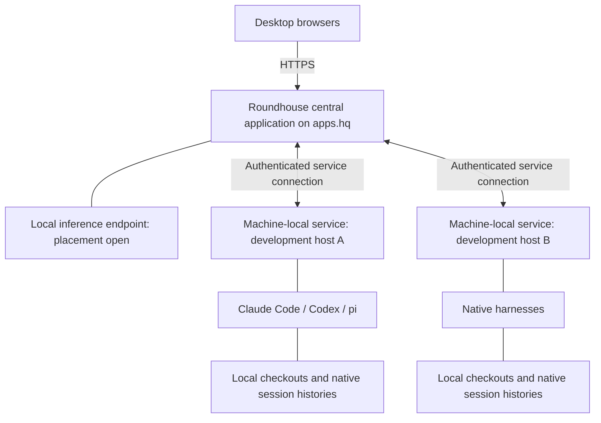

# Roundhouse

## Status and purpose

Design draft for discussion. This is a future-state description, not a report of built behavior or an implementation work order. Explicit decisions, provisional directions, and open questions are distinguished below. The harness evidence lives in `docs/research/harness-capabilities.md`; implementation planning must check installed versions rather than assume those observations hold forever.

Roundhouse is a project-oriented workspace for working directly with a gang of heterogeneous coding agents across development machines. It provides one place to converse, see where attention is needed, and return to work without reconstructing a collection of terminal windows. It is not an autonomous coordinating agent, a replacement coding harness, or an IDE.

Michael regularly makes circuits between projects, each often containing several collaborators. The friction is not merely switching windows: it is recovering what each agent needs, which conversation to enter next, and which agents are waiting on decisions or artifacts from elsewhere in the project. After an outage, this becomes a larger reconstruction task: finding the native sessions, recognizing them among GUIDs, and rebuilding the working arrangement.

Roundhouse addresses both problems by preserving the arrangement independently of the processes doing the work. A reboot should interrupt execution, not erase the project map. Deliberate suspension should let Michael put a project down with its conversations and place retained.

## Explicit decisions

- Roundhouse is a single-operator workspace for Michael, accessible from multiple browsers on the network.
- It is a first-class web application hosted on `apps.hq`, reachable at `roundhouse.hq.quigley.com`.
- Browser authentication uses an application-managed local username/password database. External identity integration and multi-user sharing are not initial requirements.
- Each development environment runs a machine-local service coordinating its local harnesses. The central application communicates with those services.
- Claude Code, Codex, and pi remain native harnesses. Roundhouse accommodates their capabilities rather than replacing their agent loops.
- Michael speaks directly to the agents. An intermediary model is not required to send messages or make operational decisions.
- Projects are registered from existing checkouts on connected hosts. Roundhouse does not initially clone repositories or provision environments.
- A project's agents generally run together on its development host. Project registration supplies the default host and checkout for new conversations.
- Pane remains independent. Roundhouse may become the central place for project-related work without absorbing pane; repo artifacts remain the existing handoff for pane-originated design.
- Normal launches should happen through Roundhouse, but adoption of existing native sessions and return to native terminal use are important capabilities.
- Early versions rely on operator care for exclusive session ownership during handoff. Stronger exclusion machinery is deferred; the known concurrent-writer hazards remain visible.
- The interface remains project-focused, with a readily available cross-project attention view. Both a compact list and a next-waiting-conversation shortcut are wanted.
- Local inference is the preferred starting approach for short state summaries that help explain what agents need and who is waiting on whom. It assists reading, not execution.
- The conversation is the primary working surface. Existing IDEs, editors, and other tools remain the place to inspect project files and diffs.
- Deliberate project suspension stops harnesses while retaining involved native session identities. Resume restores access to those conversations, not a fresh agent primed with a summary.
- Desktop is the first-version target. Mobile and parameterized bootstrap presets are deferred.

## Working model

### Project

A project is the stable home for work in the interface. It has a display name and a registered development host and checkout. Its conversations remain associated with it when their processes exit, its host goes offline, or the project is deliberately suspended.

Registering a project is a small operation: choose a connected host, select or enter an existing checkout path, and name the project. Path validation happens on that host. Removing a project from the workspace must not imply deleting its checkout or native session histories; the exact removal/archive interaction remains open.

The initial ordinary case is one project registration pointing at one checkout on one host. Multiple registrations for worktrees or other environments may be useful, but cross-host project routing and automatic checkout synchronization are not implied requirements.

### Conversation

A conversation is a durable workspace identity associated with a native harness session. Its native session ID, host, and checkout are plumbing, not its only human-readable identity. Unnamed conversations still retain their project placement and recognizable recent context.

A conversation is not a permanently assigned role. Small changes may use one agent for design, planning, and implementation, and an existing conversation may cover several small changes. Larger efforts often start fresh design, planning, and implementation conversations. Fresh-context review and implementation practices remain possible; Roundhouse must not merge model contexts simply because it groups their conversations.

Provisional interface direction: roles such as Design, Planning, and Implementation are optional editable labels. Projects may contain conversations directly or gather related conversations into an optional named work group. Grouping should not be mandatory before starting work or imply a pipeline engine. The precise group creation and movement interactions are still to be refined.

### Runtime

The runtime is the currently executing harness process or server-managed thread. It can stop without the conversation disappearing. Reopening a conversation need not start a model turn or even immediately start a process.

This distinction is demonstrated by the probes: Claude can present stored history while no runtime exists; Codex and pi can reopen into an idle runtime without new model work. Roundhouse should expose the useful common experience without pretending these mechanisms are identical.

## The desktop workspace

The main surface has persistent project/conversation navigation and one generous selected conversation. A project’s collaborators should remain easy to recognize and switch between while Michael makes circuits across the wider workspace.

Provisional layout:

```text
+---------------------------+------------------------------------------+
| Needs you                 | Project / work group / conversation      |
|                           | Harness · model · effort · host/checkout |
| Projects                  +------------------------------------------+
|  archive                  |                                          |
|    Storage durability     | Conversation                             |
|      Planning             |                                          |
|      Implementation       | Messages, tool activity, requests,       |
|  frame                    | and readable native history              |
|  punchbuggy               |                                          |
|                           +------------------------------------------+
| Suspended projects        | Reply                                    |
+---------------------------+------------------------------------------+
```

Exact panel dimensions, typography, and placement are not settled. Start with one selected conversation; side-by-side viewing is a possible later addition, not an initial commitment. Keep navigation stable rather than continually sorting collaborators by their latest output. Project structure should become familiar spatially.

The selected conversation identifies its harness, current model/effort where available, and physical host/checkout. Those details should be quiet but accessible, especially when adopting sessions or returning after an outage.

Launching a conversation should ordinarily mean choosing the harness and supplying the opening prompt. Host and checkout come from the project. Exposing model and effort with supported changes is a provisional first-version direction; each adapter must disclose what can change live versus only on next launch. Inherit native settings where appropriate rather than silently substitute a stripped-down environment. Bootstrap templates and saved launch presets can follow later.

## Attention across projects

Michael alternates between making a circuit through waiting agents and focusing on a project's structure. Roundhouse serves both modes without making either mandatory.

The attention navigator offers a compact cross-project list and a keyboard action to move directly to the next waiting conversation. Both routes open the conversation within its project context. Replying should not automatically move focus away: a response may begin a longer discussion, not finish a queue item.

Provisional behavior:

- Opening a conversation acknowledges what was read, not a pending permission or question.
- Preserve reading position and distinguish content new to Michael from merely recent activity.
- Keep unread output distinct from an explicit request requiring intervention.
- Present inferred attention suggestions separately from native requests, even if both are accessible from the same navigator.
- Last operator interaction may be useful secondary context, but it is not the primary explanation of which agent is waiting on whom.

Attention ordering, shortcut behavior at the end of the list, and manual dismissal/snoozing are open interaction details. A sensible initial ordering should not be mistaken for a priority judgment about the work.

### Native facts and inferred meaning

Native protocol state supplies facts: runtime active or idle, explicit question, approval request, completed turn, error, or disconnected/unknown state. It does not reliably explain the project's next move. An ordinary prose response may be a question, a handoff, or a report that the agent has stopped.

Local inference supplies a short reading of the work, for example:

```text
Planning
  Needs your decision on migration compatibility.

Implementation
  Appears to be waiting for the revised work order.
  Planning has since posted a revision.
```

These summaries should relate the relevant conversations within a project, not merely summarize each transcript independently. They are derived views, not new project truth or authoritative dependency declarations.

Provisional inference design:

- Summarize bounded recent exchanges and relevant tool/request events after meaningful activity rather than on every token.
- Link claims to supporting messages or artifacts where possible. Uncertainty should survive into the wording.
- Mark a summary stale when newer relevant activity arrives; label unavailable summaries rather than presenting old interpretations as current.
- Allow a path back to full conversation context. Do not compress away a decision just to fit a status line.
- Native pending requests and runtime facts take precedence over a summary.
- Inference failure does not block reading, replying, approvals, launching, or suspension.
- Summaries do not send messages, approve tools, resume work, or change repository artifacts.

The model endpoint, context budget, trigger/coalescing policy, and treatment of contradictory summaries remain open. Initial evaluation should ask whether summaries save Michael from rereading multiple conversations, not whether they create a complete formal workflow graph. An agent status-reporting convention is not required initially.

## Architecture and ownership



### Central application

The central application presents the workspace, handles browser login, associates projects and conversations with hosts/checkouts/native identities, tracks attention and reading state, and coordinates access to inferred summaries. Browsers communicate with this application rather than directly with harness endpoints.

Provisional direction: workspace structure, reading state, and attention state follow Michael between browsers, while unsent reply drafts remain browser-local to avoid overwriting another window's draft. The consistency rules for simultaneous browser use still need specification.

### Machine-local service

The machine service owns managed execution: launching native harnesses, draining event streams, tracking current requests, delivering replies, and conducting harness-specific shutdown and resume sequences. It continues independently of browser and central-application availability.

The reconnect probes demonstrated why this service is more than a process launcher. It needs a current pending-request set as well as conversation events. Replaying an old request event does not establish that the request is still actionable. Native late responses may be silently ignored, so Roundhouse should give the interface an explicit result when its own current state shows a request is no longer pending.

The local service should retain enough durable session registration and launch information to account for its managed conversations after restart. How that information is reconciled with the central workspace is an open contract; duplicating associations must not result in two authorities independently spawning the same session.

The machine service is not a pipeline engine. It does not choose agents, move stages, decide that a work order is ready, or replace mercurius and terminus.

### Harness adapters

Use supported structured interfaces and preserve native semantics. Normalize only what the interface actually needs; retain harness-specific capabilities and limitations. Do not scrape terminal display output as the ordinary conversation transport.

Adapters must account for native configuration loading, trust, tools, permissions, model selection, and interruptions rather than assuming programmatic mode equals a normal terminal launch. No silent weakening of permission settings is acceptable as an integration convenience.

### Connection and authentication

The browser login uses the established local account model. Machine authentication is separate from the operator's browser password, with independent registration and revocation. This system exposes coding agents with local filesystem and command capabilities, so being on the network is not sufficient authentication.

Provisional direction: machine services initiate persistent authenticated outbound connections to apps.hq, with commands flowing back over them. This simplifies the known destination and avoids exposing development hosts directly to browsers. Connection direction, wire protocol, TLS termination, machine credential enrollment, retry rules, and version/capability negotiation are not yet settled.

Password storage and browser sessions should use established secure practices, not bespoke cryptography. Exact login bootstrap, password reset, session lifetime, CSRF/origin protection, and host enrollment mechanisms belong in the next security/design pass. Multi-user authorization is not needed, but single-operator does not remove the need to protect command delivery.

## Persistence and recovery

Roundhouse has three distinct persistence concerns:

1. Workspace arrangement: what projects and conversations exist and where Michael left them.
2. Native conversation history: the harness's durable session identity and transcript.
3. Operational evidence: what execution and requests were last observed and what is currently confirmed.

Native histories remain owned by native harnesses. Roundhouse may need indexed or cached conversation data for display, summaries, and offline visibility; storage format, retention, replay, and synchronization are open. It should not silently become a second authoritative native transcript store. Project intent and memory remain in repository files.

### Browser and central interruption

Closing a browser must not stop agents. Restarting the central application should not terminate host-managed execution. When the interface returns, it recovers missed activity and the current pending-request set without replaying prompts or approvals.

The probes established this with an in-memory local owner that remained alive. A production promise requires a deliberate retention/replay contract, including what happens if the missed event interval is no longer available. Do not infer durable recovery from the probe's ring buffer.

### Host or machine-service interruption

An unavailable host is not proof that its agents stopped. Show last-known evidence as such and preserve the project in the workspace. On reconnect, reconcile surviving processes and native history before proposing continuation.

Claude may continue and persist work after its owner dies. Codex may leave a child command running after an interruption and server exit. Pi may preserve a tool call without its result. These observations rule out treating the last received message, process exit, or interruption acknowledgment as a universal completion boundary.

Restore visibility automatically; resume uncertain execution deliberately. Do not replay an in-flight command or an old permission decision merely because communication returned. A command may have produced effects even if its completion was never observed.

Whole-machine power-loss durability, owner-crash recovery of requests, persistence acknowledgments, and protection against accidental duplicate launches remain open. The desired user experience is explicit; the probes have not yet established every guarantee needed to deliver it.

## Suspension and resumption

Suspension is intentional, distinct from a crash or an unreachable machine. A suspended project retains its conversation roster, native identities, placement, and reading context. It does not reactivate merely because its host restarts.

The ordinary case is a stopping point: idle managed conversations shut down cleanly. On resume, those same conversations become available with history intact and without new model work. For Claude this can mean displaying history first and starting a runtime only with the next prompt.

For active work or pending requests, show what prevents straightforward suspension and let Michael choose to wait or interrupt. Adapter-specific cancellation handles native requests; do not approve an operation just to make shutdown finish. Pending approval UI must not survive as an actionable approval if the runtime no longer recognizes it.

Partial suspension is possible. If a harness, tool process, or externally controlled conversation remains active or cannot be verified, do not declare the whole project fully stopped. The product must define what evidence is sufficient for each reported state without promising to discover every unrelated process on a machine.

Project-level suspension is agreed. Conversation-level and optional work-group suspension are provisional extensions of the same operation; their exact initial scope remains open.

## Adoption and terminal use

Adoption starts by discovering or selecting a native session on the registered development host and associating it with a project conversation. Discovery, reading stored history, cold resumption, and live control are distinct capabilities. Do not call all four “attach.”

For the initial Claude and pi paths, cold handoff is explicit: stop the managed writer, open the exact native session in the terminal, close that writer, then resume under Roundhouse. Idle is not closed. Operator care is the accepted early mechanism; no mandatory lease system, native-process exclusion, or terminal wrapper has been decided.

Codex demonstrated native remote TUI access to the same managed app-server thread, including approval handling. Preserve this as a possible richer adapter capability. Its transport is experimental upstream, approvals are broadcast, and first response wins. Any browser “terminal control” indicator must not imply an exclusive lock the native server does not enforce.

Terminal use need not erase workspace membership. A conversation can remain visible as externally operated, with observation limited to what the harness safely exposes. Full release from management and ordinary terminal handoff are conceptually different; exact actions and observability promises remain open.

Do not replace native continuity with a summary-fed new session without an explicit separate operation. No such replacement is required for the initial handoff paths demonstrated by the probes.

## Scenarios

### A circuit across projects

Michael opens Roundhouse and sees several projects with new responses, one explicit approval, and a planning question. He selects the question from the attention list; the project structure and collaborator summaries remain visible. After replying, he stays long enough to clarify the agent's response, then uses the next-waiting shortcut. Reading a message does not approve or dismiss its unresolved request.

### Recovering a project's next move

Planning has proposed a change while implementation is waiting for a revised work order. The local-inference summary points out that relationship and links to the relevant exchanges. Michael opens planning, makes the decision, and returns to implementation when ready. Roundhouse does not forward the decision or start the next stage on his behalf.

### Putting work down

At an idle stopping point, Michael suspends a project. Its managed harnesses stop; its conversations remain arranged and named. Days later he resumes it and sees the same histories and context. Nothing begins editing files until he explicitly sends work.

### Returning after an outage

The central workspace returns with the same project roster. One host is offline; another reports native history newer than Roundhouse's last observation. The interface distinguishes those states and offers inspection/resumption rather than presenting every conversation as stopped and ready to retry. Deliberately suspended projects remain suspended.

### Returning to the terminal

Michael hands a Claude conversation out to the native terminal after closing the managed writer. Its Roundhouse identity remains in place. After exiting the terminal, he resumes it through Roundhouse and sees the intervening turns. For a supported Codex shared-server session, native terminal access may instead use live attachment without replacing the managed backend.

## Seam census: decisions and open calls

This records the boundaries discussed so far; unresolved calls are not silently delegated to implementation.

| Boundary | Status and call | Why / revisit condition |
| --- | --- | --- |
| Operator / coordinating model | Decided: direct operator-to-agent conversations | Inference helps read state; automatic delegation is outside initial scope. |
| Central workspace / local execution | Decided: separate responsibilities | Browser and central availability must not govern execution. Detailed state reconciliation remains open. |
| Roundhouse / native harness | Decided: preserve native harnesses and identities | Supported adapters, not replacement agent loops. Revisit capabilities as harness versions change. |
| Native facts / inferred summaries | Decided direction: distinguish clearly; inference cannot execute | Summaries may be wrong or stale without compromising requests or control. |
| Project artifacts / workspace metadata | Decided direction: repositories retain project truth | Grouping, reading state, and summaries must not create competing specs or agent memory. |
| Session identity / runtime | Decided direction: separate | Suspension, cold handoff, and outage recovery require persistence beyond process lifetime. |
| Ownership convention / enforcement | Decided: operator care initially | Known Claude/pi concurrent-writer hazards retained; stronger enforcement is deferred. |
| Model / transport | Open implementation boundary | Native protocol details need adapter confinement; exact domain/event model awaits design. |
| Model / rendering | Open implementation boundary | Do not prescribe shared view/domain types before the interface and consumers are grounded. |
| Failure handling by layer | Provisional: local execution failure remains local; central shows uncertainty | Exact error taxonomy, replay, and retry behavior need a contract; disconnection must not imply safe retry. |

## Open questions for the next design pass

- Durable state ownership and reconciliation between central workspace, machine registry, event cache, and native histories, especially after owner or whole-machine failure.
- Command delivery acknowledgment and uncertain outcomes: how to avoid duplicate prompts, launches, and approvals during reconnect without claiming more than the native protocols support.
- Authenticated host enrollment, transport, connection direction, capability/version negotiation, and credential revocation.
- Suspension completion criteria for active or background tools, especially Codex's surviving-child observation; how partial/uncertain shutdown is presented.
- Adoption selection, external-terminal indicators, removal/archive semantics, and the extent of initially supported live Codex attachment.
- Attention ordering, read-state synchronization across browsers, stale-request handling, and inferred suggestion dismissal.
- Optional group interactions and suspension scope below the project level.
- Local-inference placement, evidence references, context budget, retention, and stale-summary policy.

These are targeted design questions, not an invitation to restart the broad harness investigation. Further experiments should answer a concrete unresolved contract.

## Deferred (and why)

- Mobile-first layout and phone workflows: desktop is the actual working environment; mobile is a possible later fallback.
- Parameterized bootstrap prompts and saved launch presets: useful recurring practice, but manual opening prompts suffice initially.
- Embedded IDE, diff viewer, and file editing surfaces: existing tools already serve inspection and editing.
- Pane integration or replacement: pane remains independent; repo artifacts already provide the handoff.
- Autonomous delegation, agent-to-agent messaging, and automatic stage advancement: the purpose is direct coordination with Michael's judgment intact.
- Strong cross-process ownership enforcement: operator care is explicitly accepted for early versions.
- Repository cloning, environment provisioning, and checkout synchronization: projects begin from existing development environments.
- Multi-user projects, sharing, and role administration: this is a single-operator workspace.
- Universal live terminal attachment: not supported across the tested harnesses; cold native resumption is an honest baseline.
- Permanent side-by-side conversation layouts: a single generous conversation with fast navigation is the provisional starting point.

## Handoff posture

Refine the open contracts with Michael before treating this as implementation-ready. A planning agent should translate the settled design against the repository and tested harness versions, not turn provisional suggestions into requirements by default. The existing probes are evidence and potential regression checks, not a preselected production architecture.

Formatting note: this draft was written through filesystem tools without command execution. Run `unfurl -i docs/future/roundhouse.md` before the next document handoff.
